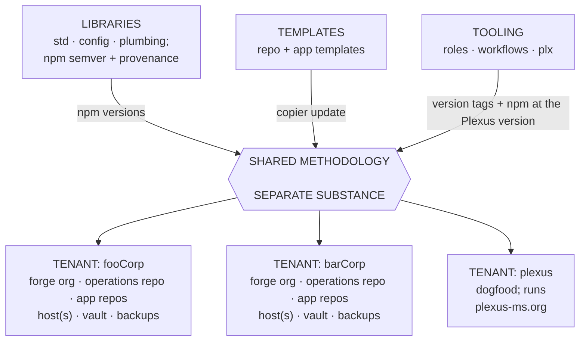

Plexus is a coherent collection of opinionated guidelines and approaches in information technology.
The ambition is that everything its maintainers know about IT is eventually encoded here, which mainly revolves around building software and operating it.

This document, referred to as the Plexus Standard, PLX, or simply "the standard", is the map of that collection.
Each section explains the concern and points at the **modules** that cover it; where no module exists yet, a stub says so.
Requirements live only in the modules themselves.

*Cite a map section by number and the short name PLX ("§ 4.1 PLX"); cite a module section by number and the module's code ("§ 2 PLX-App").
Section numbers are append-only within a major version: new sections go at the end of their level, so a citation stays correct until the next major release.*


## § 1 General provisions

### § 1.1 Structure and normative language

The standard has two layers.
The **map** is this document: prose and pointers, no requirements, no normative keywords.
A **module** is a page under `contracts/` or `approaches/` that covers one concern a consumer could adopt or reject on its own, and it is where requirements live.

A module at standard maturity states its requirements as named, blockquoted bullets at the head of each numbered section (§ 1.3), using the capitalised keywords of BCP 14 ([RFC 2119](https://www.rfc-editor.org/rfc/rfc2119), [RFC 8174](https://www.rfc-editor.org/rfc/rfc8174)).
Everything outside such a bullet is informative: the prose below a requirements block explains and motivates, but never binds.

### § 1.2 Vocabulary

The following terms are used throughout Plexus.

Plexus revolves around tenants sharing methodology but never substance:

- **Tenant** — one trust domain in the federation: its own forge org, repos, hosts, secrets vault, backups ([PLX-Tenancy](../contracts/tenancy.md)).
  The boundary that matters is access and trust, not necessarily legal personality.
- **Methodology** and **substance** — the sharing axis: methodology is knowledge and code-shaped-as-knowledge, shared across all tenants; substance is data, secrets, access, hosts, and is never shared.
- **Primitive** — any named methodology (guideline, tool, or approach) the initiative ships or prescribes: a verb, a mount, an Ansible role, a published package, a copier template, a label scheme, a file layout, an endpoint path.
  Decided once, reused, versioned and published, or otherwise propagated (§ 13).
- **Seam** — where two sides owned by different people or tools meet: one layer and the next, or the authors of a repo and whatever runs it.
  A seam is named by its two sides and made explicit as exactly one contract (§ 1.3).
- **Module**, **contract**, **profile**, **approach**, **requirement**, **check**, **maturity** — see § 1.3.
- **Marker** — the `PLEXUS.md` at the root of every repo and every app: an app's profile, and the requirements the unit does not meet, with the reasons (§ 1.4).
- **Plexus version** — the one number Plexus carries: a plain semver tag stamped identically on `tooling`, the templates and the compendium; a repo is on the version its `plx` pin names (§ 1.5).
- **Tooling** and **libraries** — the two ways a primitive reaches a tenant: tooling runs around an app and carries the Plexus version, a library is imported by an app and carries a version of its own (§ 1.5).
- **Template** — a copier template a repo or an app is generated from and re-synced with; the template is what does an approach (§ 1.3, § 13.3).
  *Preset* is the update bot's word for a shared configuration and means nothing else in Plexus.

Tenants usually build and ship software:

- **Repo** — one release cycle and one toolchain inside a tenant bundled in one forge repository ([PLX-Repo](../contracts/repo.md)).
  A tenant can have any number of **app repos** holding the dev side, and has exactly one **operations repo** holding the ops side, which the tools know as the repo generated from the operations template ([PLX-App](../contracts/app.md)).
- **App** — one deployable unit satisfying the app contract ([PLX-App](../contracts/app.md)).
  It lives in an app repo for software the tenant builds, or the operations repo for third-party software the tenant merely operates.
- **Verb** — a stateless, hand-runnable procedure that does one operational thing, authored portably.
  Ops verbs are commands of `plx`, the published `@plexus-ms/cli` ([PLX-CLI](../approaches/cli.md)); contract verbs are the root mise tasks the repo contract requires.
- **Mount** — the thin, disposable glue binding a verb or role to an event or state source it does not own: a workflow wrapper on forge events, a tenant playbook on an inventory, a systemd timer on the clock.
  Mounts carry no logic.

IT operations is a layered concern. We are adopting the commonly used language of on-premises, IaaS, PaaS, and SaaS:

- **App/Software layer** — on top of the platform layer, the software a tenant provides as a service and the data it holds.
  These are the apps the tenant builds in its app repos and the third-party apps it merely operates from its operations repo, each meeting the app contract ([PLX-App](../contracts/app.md)).
  It is the equivalent of a tenant being its own SaaS provider, and it is the dev side: everything from the domain core up to the seam where the platform provides the surroundings.
- **Platform layer** — what makes any existing production host run a tenant's app and provide it as a service: the host baseline, the container engine and proxy, ingress, environment and secrets delivery, applied by the operations repo's playbooks ([PLX-Platform](../approaches/platform.md)).
  It is the equivalent of a tenant being its own PaaS provider, running the layer between the infrastructure below and the apps above.
- **Infrastructure layer** — underneath the platform layer, this is what makes a tenant's hosts exist, reachable, and restorable.
  The hosts are bought from a provider as IaaS (virtualized cloud instances etc.), or built by the tenant on bare metal of its own (on-premises or bare metal rented from a provider, [PLX-Infrastructure](../approaches/infrastructure.md)).


### § 1.3 Modules and maturity

A module has a kind and a maturity, and the two are independent axes.

#### Contracts and approaches
The modules' kind divides them into `contracts/` and `approaches/`.

- A **contract** is the interface at a seam: what the two sides owe each other, so that either side can be replaced without the other noticing.
  It consists of named requirements (below), each saying which side it binds.
  Contracts are opinionated interfaces, not tool-neutral ones: the repo contract names mise, the app contract names compose, the host contract names Debian.
  A unit is bound by a contract by being what the contract binds: every repo by the repo contract, every app by the app contract, every tenant by the tenancy contract; no file lists them.
  See the [contracts index](../contracts/index.md) for the table of all seams.
- A **profile** is a named variant of a contract, and a unit takes exactly one of its contract's profiles: an app is `stateless` or `stateful` ([PLX-App](../contracts/app.md)).
  A profile is a part of its contract's page, with requirements named under it, and the unit states its profile in its marker (§ 1.4).
- An **approach** is one way to live on one side of a seam: to provide a contract, to consume it, or to do a side's own job; every module that is not a contract is one.
  It consists of a page that says why and a template that does it, with the tooling the template pins.
  Where an approach varies, the variation is its template's questions, as many as it needs: the delivery approach asks, among others, where a repo's CI jobs run and where its images are kept ([§ 8 PLX-Delivery](../approaches/delivery.md)).
  A unit takes an approach by its answers file for that template, which records the answers it gave.
  A tenant can replace an approach with its own and remain a Plexus tenant as long as it keeps the contracts.

**Three rules for contracts and approaches:**

- One seam, one contract; a profile is a part of its contract, not a seam of its own.
  A new contract needs a new named seam with two owners, and a page that cannot name its seam is an approach.
- A module reaches across a seam only through a contract; on its own side of the seams it is composed with other modules: you took this piece, so you have the whole it belongs to.
  A page's frontmatter records both, for the reader (below).
- A contract page is two-sided: each of its requirements says which side it binds, and its Maintaining section lists the approaches on each side.
  A guarantee that one side relies on from an approach on the other side moves into the contract at that seam, and the approach keeps the how.

#### Requirements and checks
A **requirement** is one obligation, stated on one line of a module page: a blockquoted bullet that opens with the requirement's name in backticks and a colon, as in `` > - `PLX-App/LoopbackPort`: … ``.
A name has the form `<module>[/<profile>]/<name>`: the module's code, the profile where the requirement belongs to one, and a name of its own, each segment capitalised, as in `PLX-App/LoopbackPort` and `PLX-App/Stateful/MigrateService`.
A requirement is cited by its name, in code and in prose; section numbers cite the prose around it.

A **check** is a test that `plx doctor` runs in a repo for one requirement (§ 13.4).
Only a requirement on the side of the unit that runs it, the repo or the app, can have one; a requirement that binds the platform, the deployer, an operator or an organisation has none.
Below each block of requirements, the page names those that have a check, and says what the check covers where it covers only part of its requirement; a requirement the page does not name there has no check.

In an approach, what the template does is prose, since the template is how the approach is done.
A requirement remains only where the approach binds people, to a choice or an act no template can make for them, and such a requirement has no check.
An approach is verified upstream instead: its template is rendered, and the checks of the contracts are run on the result.

#### Maturity: note vs. candidate vs. standard
- A **note** is written knowledge: no primitives, no requirements; a page the map links to and nothing more.
- A **candidate** has shipped primitives and at least one consumer, and still no requirements: a candidate for standard, waiting on its second consumer.
- A **standard** module has requirements and at least two consumers.

Only candidate and standard modules carry a code, `PLX-` plus one capitalised word, unique across the compendium.
Notes have titles and no code.

#### Granularity
Modules are cut for understanding: one module per concern a reader can hold in their head, so that someone who needs to know how delivery works reads one page and not four.
A module says at each section which kind of consumer it binds, and a unit that does not meet one of its requirements owns that in its marker (§ 1.4).
Ingress, secrets delivery, and backups are separate modules because they are separate concerns to the reader, although one playbook mounts them.
The delivery verbs, the branch model and the deploy semantics are one module because a reader of any of them needs the others.
Granularity is revisited while pages are written and when a reader has to hold two pages open.

#### Frontmatter
Every module page carries `code` (except for notes), `maturity` and `binds` (what the module binds: `repo`, `app`, `host`, or `organisation`).
It also carries `depends`, the modules on the same side of every seam that this one is composed with, and, on approaches, `consumes`, the contracts on the other side of a seam this module relies on.
`depends` and `consumes` are informative: they show the reader how the modules fit together, and no tool reads them.

#### Page shape
Numbered sections (`§ 1`, `§ 1.1`, …) hold requirements as named `> - ` bullets followed by prose; numbers are append-only within a major version, as in the map.
One trailing section headed *Maintaining*, unnumbered and never cited, holds the maintainer side in plain rules.
They say which template and tooling implement the module, what the maintainers keep to when they change it, on a contract the approaches on each side, and what promotes it to the next maturity.
It holds no debts and no history (§ 1.8).
The extractor treats that section as prose.

### § 1.4 The marker

Every repo and every app carries a `PLEXUS.md` marker at its root (`PLX-Repo/Marker`, `PLX-App/Marker`):

```markdown
---
profile: stateful
deviations: [PLX-App/Stateful/MigrateService]
---

- Free-form prose: what this app is, how to find your way.
- `PLX-App/Stateful/MigrateService`: the image migrates its own schema on startup and offers no separate migrate step.
```

The frontmatter holds two fields.
`profile` is an app's profile, `stateless` or `stateful`, and only an app's marker carries it.
`deviations` lists by name the requirements the unit does not meet, and the body gives the reason for each, one bullet per deviation; otherwise the body is free-form prose for humans.
Machine checks read only the frontmatter.

What a unit follows is not listed: a repo is bound by the repo contract and an app by the app contract by being one (§ 1.3), and a unit takes an approach by its answers file for the approach's template.
The Plexus version is not in the marker either: a repo is on the version its `plx` pin names (§ 1.5), and an app is on its repo's.

### § 1.5 Versioning

Plexus has one version, the **Plexus version**: a plain semver tag (`0.60.0`, no `v` prefix) stamped identically on `tooling`, the three templates and the compendium, whether or not each of them changed.
The number says *when*, not *how stable*; stability is the maturity axis of § 1.3.
It names the tested set: the only combination ever validated is the one the maintainers' tenants run together, so independent per-repo version lines would name compatibility cells nobody tests.
Because an unchanged repo still gets the tag, every cross-repo pin can cite the Plexus version and be right by construction.
A tenant repo records the version it is on in one place, its `plx` pin in `mise.toml`, moved by the pull request by which it takes a version (§ 13.3).

**What is versioned how.**
Every primitive (§ 1.2) reaches a tenant in one of two ways, and the way decides how it is versioned.

| | Tooling | Libraries |
|---|---|---|
| What | The `plexus.*` Ansible collections, the Terraform modules, the reusable workflows, `plx` and `plx-ci`, the shared update-bot preset, the templates. | `@plexus-ms/std`, `@plexus-ms/config`, and over time the application plumbing of § 4.6. |
| Where it lives | `tooling` and the three `template-*` repos. | `libraries`. |
| How a tenant consumes it | Around its apps: by tag, by a pin in `mise.toml`, by a template. | Inside its apps: as a dependency in a `package.json`. |
| Version | The Plexus version, all of it together. | Each package its own semver, by changesets ([§ 5 PLX-Delivery](../approaches/delivery.md)). |
| Who moves a tenant's pin | The pull request by which a repo takes a version (§ 13.3). | The update bot (§ 13.2). |

The line follows from what a version number costs on each side.
Tooling has no versioning of its own beyond a git tag, and only the combination is ever tested, so one number for all of it is the honest one.
A library sits in an app's dependency closure, where its version is an input of the app's build.
A number that moved while its files stood still would rebuild every image for nothing, so a library's version moves only when the library does.
Two rules keep the line where it is.
Tooling and libraries meet only through contracts (§ 1.3), never through a shared version number: nothing that carries the Plexus version is a dependency of an app.
And a repo of its own is warranted only by releases of its own or by a technical necessity, as a copier template has to be a repository; everything else joins `tooling` or `libraries`.

`tooling` carries everything of the first kind that is not a template: the four `plexus.*` Ansible collections and the Terraform modules, the reusable workflows, the shared update-bot preset, and the packages `@plexus-ms/cli`, `@plexus-ms/cli-ci` and `@plexus-ms/lib`.
Each collection's `galaxy.yml` version mirrors the tag exactly, and the packages are published to npm at the Plexus version, so that the tools a repo runs and the version it is on are one number.
The tool that cuts a version, `plx-dev`, lives there too and is never published: the maintainers run it from their `tooling` checkout, so it is always the code at `main` and never a release behind the one it cuts.

**Semver attaches to maturity.**
A breaking change to a standard module's requirements forces a major version, with its migration steps in that version's release notes; candidate and note modules change in any minor version.
Section numbers in the map and in every module are append-only within a major version, so a citation written against one version stays right until the next major.
While the Plexus version is `0.x` it promises nothing, and any version can change anything; it leaves `0.x` once the modular standard with its first standard modules has shipped and settled.

**Cutting a version.**
The maintainers cut a version when the methodology has moved, with `plx-dev ship` run from their `tooling` checkout over their workspace (`mise ship` there).
It writes the bookkeeping: every pin that names the Plexus version ([§ 1 PLX-Updates](../approaches/updates.md)), and the version and timestamp in this document's frontmatter (a draft carries `v0` until its first version).
Then it tags and releases every versioned repo: `tooling` first, whose release publishes its packages, then the templates and the compendium once the registry has those packages, since they pin them, and the compendium last.
Every release lists the subjects of the commits since the previous version, so a tenant reads there what a version concerns.
The step of the number is the maintainers' to choose, and it says how urgently a repo takes the version (§ 13.3).
A hotfix is cut as a patch, routine work as the next minor, which `ship` picks when it is given no version, and a changed contract as a major; `ship` checks nothing about the step.
A patch, like any version, is cut on every versioned repo.
`ship` ends there and opens no pull request in any consumer: cutting a version and a repo taking it are separate events, and the taking is the repo's own (§ 13.3).
Its preflight, its two phases and its recovery from a half-tagged version are stated in the header of its source.

### § 1.6 Upstream guarantees

Whoever controls `plexus-ms` ships code and knowledge-shaped-as-code that reaches deep into every tenant's hosts, inside every tenant's CI, and inside every tenant's apps.
Adopting the standard means trusting its maintainers.
The mitigations are structural, and the tenant can rely on them:

- The `plexus-ms` repos are public and GPLv3-licensed; every change is reviewable, and nothing breaks on the day the upstream goes unmaintained: published versions keep resolving, tags keep resolving, and the repos remain forkable.
- `@plexus-ms/*` packages are published to the public npm registry through OIDC trusted publishing; published versions are immutable and carry provenance attestations linking each version to its source commit and build.
- A breaking change to a package on its own semver line is released as a semver major, with a migration note in the changelog.
  The packages that carry the Plexus version (`@plexus-ms/cli`, `@plexus-ms/cli-ci`, `@plexus-ms/lib`) follow its semver, so a breaking change to them, like one to a standard module, is a major version (§ 1.5).
- Tenant substance, business logic, secrets, anything tenant-specific, never appears in a public package or a public repo.

These are obligations of the maintainers, not of consumers, which is why they are prose here rather than requirements in a module.
They are the upstream's side of the tenant-to-federation seam (§ 1.3), whose tenant side is [PLX-Tenancy](../contracts/tenancy.md).
The tenant's decision on how unattended to let updates flow ([§ 2 PLX-Updates](../approaches/updates.md)) rests on them.

Some pins reference git tags, which git itself lets move; a retargeted tag would silently change what a tenant executes, with no attestation.
Every version tag of the repos that carry the Plexus version, `tooling`, the templates and the compendium, is therefore locked by an immutable GitHub release, created by `ship` and verified by it.
Once published, the tag can neither be moved nor deleted, and the packages of `tooling` are published from such a release (§ 1.5).
Referencing by commit SHA remains the alternative should attestation of tag-referenced artifacts ever be wanted.

The repos that ship the methodology:

| Repo | Offering |
|---|---|
| `tooling` | The primitives that run around an app, at the Plexus version, in one repo: the `plexus.*` Ansible collections, one per layer with its playbook (`plexus.host` for the baseline every host gets, `plexus.platform`, `plexus.infrastructure`, `plexus.ci`), and reusable Terraform modules; the thin reusable workflows that mount the ops verbs on the forge; `plx` itself as `@plexus-ms/cli` with `@plexus-ms/lib`, and the CI verbs as `@plexus-ms/cli-ci` (`plx-ci`); `plx-dev`, the unpublished tool that cuts a version; and the shared Renovate preset every Plexus repo extends in one line. |
| `libraries` | The primitives an app imports, the published `@plexus-ms/*` libraries for the web/Node/TypeScript world, each on its own semver: the `std` utilities, the shared tool configs `@plexus-ms/config`, and over time the reusable application plumbing that keeps each app's domain core small. |
| `template-repo-turbo` | The copier template for a tenant app repo: a Turborepo monorepo with `apps/` consuming the packages, re-syncable via `copier update`. |
| `template-app-nextjs` | The copier template for a Next.js app inside an app repo: contract-verb scripts, Dockerfile, `compose.yaml` with the contract labels. |
| `template-repo-operations` | The copier template for a tenant's operations repo: one thin playbook per layer mounting the collection's, on request the infrastructure layer's and the CI layer's, the inventory with the standard groups, the `op://`-pointer env files, the collection pins, the `apps/` directory and workflow for third-party apps. |
| `compendium` | This map, the modules, the manifesto, and the supporting reference docs. |

The dogfood tenant `plexus` lives in its own organisation, `plexus-ms-tenant`, laid out like any tenant and bound by the contracts and the approaches it takes, not by anything in this section.
The maintainers' organisation ships methodology, the tenant's holds substance, and the two never share an access boundary.



*Figure 1 — the federation at a glance: one tenant-neutral upstream, versioned methodology flowing hub-and-spoke to every tenant, substance staying inside each tenant's own trust domain.*

### § 1.7 Governance

Deferred decisions are written into the module or map stub that owns its concern, with the trigger that reopens it.
The stubs of this map are therefore the overview of what Plexus does not cover yet, and a deferral is a decision rather than drift.

### § 1.8 Compendium conventions

All documentation of the initiative lives in the `compendium` repo.
No other `plexus-ms` repo carries a README beyond a pointer or a one-liner; a role's variables are documented in its defaults, a verb in its header.

The compendium states the present only, and each fact has one home.
What a consumer must do, and why, is the module's.
How a tool works step by step is the header of that tool's source file, and a module names the tool and says in a sentence or two what it achieves.
What changed and when is git history: no page carries a date, a "since version N", a migration note or a list of what was done.
What a generated file is for is one or two lines in the file itself.

Two registers.
The [Manifesto](manifesto.md) says why, and evocative language is allowed there and nowhere else.
This map and the modules say what and how, in sober prose; the modules' requirements in BCP 14, their Maintaining sections in plain rules for the maintainers.

The structural conventions are self-policing, and the machinery is small:

- The map carries no requirement and no normative keyword.
- A standard module carries its requirements as named `> - ` lines under numbered headings (§ 1.3); blockquotes are reserved for them.
- A module below standard maturity carries neither keyword nor blockquote.
- `plx requirements` checks all of that over the map and every module, validates module frontmatter, checks that every section and requirement name a page cites exists, and prints a module's requirement lines on demand.
  `mise check` runs it, and the pre-commit and pre-push hooks run `mise check`.
  It writes no file: there is no generated requirements list to keep current.
- Section numbers are append-only within a major version; insertions wait for a major.
- Module pages live at `contracts/<slug>.md` or `approaches/<slug>.md`, the folder being the kind (§ 1.3), and a new module is added to the map section that owns its concern in the same commit.

The compendium follows the repo contract it documents: tools pinned in `mise.toml`, `verify` as a verb, hooks through hk.


## § 2 Organisation

How an organisation is cut into trust domains and named, where its code lives, how it relates to other tenants, and the parts of running an organisation that are not technical at all.

### § 2.1 Trust domains and tenancy

The tenant is the trust boundary: one organisation, one forge org, one operations repo, one secrets vault, its own hosts and backups.
What spans tenants is methodology; what never does is substance.
[PLX-Tenancy](../contracts/tenancy.md) is the contract, at standard maturity; its first section holds the one pair of requirements everything else rests on.

### § 2.2 Naming

One short slug per tenant threads through every layer: forge org, hostnames, inventory groups, vault name, and the `plexus.tenant` label on every deployed service, so that staring at a host one can tell whose service this is.
[§ 2 PLX-Tenancy](../contracts/tenancy.md).

### § 2.3 Forge and repo layout

One trust domain, N release cycles, one operations repo: the ops side in a repo of its own, every other repo an app repo, app repos as monorepos by default, generated from the templates.
[§ 3 PLX-Tenancy](../contracts/tenancy.md).

### § 2.4 Arrangements between tenants

Tenants sharing hardware are separated by a hypervisor and never inside one VM; the hypervisor side sees everything, so distinct legal persons sharing root access write the arrangement down.
The common form is one tenant obtaining its infrastructure from another ([PLX-Infrastructure](../approaches/infrastructure.md)).
[§ 4 PLX-Tenancy](../contracts/tenancy.md).

### § 2.5 Documentation and knowledge

Plexus's own stance is that artifacts are the documentation (the [Manifesto](manifesto.md)) and that a tenant repo's marker body is where its non-derivable knowledge lives.
How an organisation keeps the knowledge that is not next to a system (runbooks, decisions, onboarding, user manuals) is not in our scope for now.

### § 2.6 Legal and data protection

The only requirement in this area today is the written arrangement of § 2.4, with a data-processing agreement where applicable.
Moving tenants off shared metal can be triggered by a customer with real data-processing expectations: not because the hypervisor stops isolating, but because "dedicated instance for us only" can be a compliance or trust requirement independent of the technical reality.

### § 2.7 Cost, vendors, procurement

Where the standard picks a vendor today it does so inside a module, as a suggested pragmatic default chosen by the maintainers, which a tenant can substitute by recording the deviation.

A more holistic view on cost and vendor choice across the whole stack may follow in the future, but tenants will have vastly different needs and budgets.


## § 3 Shared services

The services an organisation runs for itself and its people rather than for one app: identity, secrets, domains, mail.
Each is consumed by a module below; none has a module of its own yet.

### § 3.1 Identity and access for people

The platform's host baseline gives each human admin a personal account with key-only SSH ([§ 2 PLX-Platform](../approaches/platform.md)).

The forge org governs code access ([§ 3 PLX-Tenancy](../contracts/tenancy.md)).

Identity providers for the organisation's people and apps are operated as third-party apps today and have no dedicated module.

More approaches to identity and access may follow in the future.

### § 3.2 Secrets

Every module that needs a secret assumes one secrets vault per tenant, as the tenant is the trust boundary.

Today the standard assumes an external secrets service, with 1Password as a suggested default, reachable by a CLI that resolves `op://`-style pointers; [PLX-Secrets](../approaches/secrets.md) is how the platform consumes it.

More approaches to secrets management and more services may follow in the future.

### § 3.3 Domains and DNS

Not covered yet.

A public host is deployment substance bound to an app in the tenant's inventory ([PLX-Ingress](../approaches/ingress.md)); how the DNS zone itself is held, delegated, and changed is still to be decided.

Approaches on DNS and domain management with a focus on bringing DNS state into Git and managing it IaC-style will follow in the future.

### § 3.4 Mail

Hosts send local mail to a mailbox through a relay the tenant provides (the `mail` role of `plexus.host`); apps send through a transactional provider from their environment; neither is a standard module today.

More approaches to mail may follow in the future.


## § 4 Development

Everything a repo does before an artifact exists: the one way to run it, the toolchain behind that, how code is shared, tested, and run locally.

### § 4.1 Repo contract

A marker, mise and hk as the one executable answer to "how do I run you", and the three standard verbs `dev`, `build`, `verify`, each answering from a fresh checkout, with `verify` made of `check`, `lint` included, and `test`.
[PLX-Repo](../contracts/repo.md) is the contract every other repo- and app-level module depends on.

### § 4.2 Toolchains

The incantations behind the verbs, one module per stack.
JS/TS is specified: pnpm workspace plus Turborepo, node pinned once, dev tools as devDependencies, Biome ([PLX-JS](../approaches/js.md)).
Other stacks take the repo contract with a toolchain module still to be written.

More toolchain modules may follow in the future.

### § 4.3 Sharing code

The standard approach to share code across repos is a published, versioned artifact, and nothing else should cross the boundary.
This is not possible in all cases, and the fallback is a template synced up with e.g. copier, or even manual sync, but this should be treated as a rigorous ladder to step through:
1. versioned artifact, if possible;
2. template, if the first is not possible;
3. manual sync, if the first two are not possible.

In a JS monorepo, code that does not need to cross repo boundaries can just be an unpublished package in that monorepo.

[§ 1 PLX-Updates](../approaches/updates.md) states the rule; [§ 5 PLX-Delivery](../approaches/delivery.md) is how a JS package repo publishes.

### § 4.4 Testing

Not covered beyond the verb.
`verify` runs whatever gates a release and provides its own environment ([§ 3 PLX-Repo](../contracts/repo.md)).
What a good test suite for a Plexus app looks like, and how the domain core is engineered test-first while the edges are shared, is still to be written.

More approaches to testing will follow in the future.

### § 4.5 Local environment

Not covered beyond the verb.
`dev` takes a fresh checkout to a running development environment, and the app's `compose.yaml` runs identically in development with a local `.env` ([§ 3 PLX-App](../contracts/app.md)); development-only services next to it are each app's business today.

More approaches to local development environment standardization may follow in the future.

### § 4.6 Application plumbing

The "standardize boundaries" edges, framework glue, common auth concerns, repeatable non-domain features, are to become published `@plexus-ms/*` packages, extracted when a second app needs the same plumbing ([§ 5 PLX-Delivery](../approaches/delivery.md)).
Until then the plumbing lives in the app that needs it.

General re-use of plumbing and boilerplate is encouraged per the DRY principle.

Deferred: `libraries` as an organisation or brand of its own, separate from the standard.
The trigger is a library gaining users who do not adopt the standard; until then the libraries are published from `plexus-ms` like the rest of the methodology, on their own semver (§ 1.5).

### § 4.7 Working with coding agents

Not covered yet.

Approaches to coding agents will follow in the future.


## § 5 Application

The seam between dev and ops, made explicit as a contract every app satisfies in one of its profiles.

### § 5.1 App contract

What the platform relies on for every app: run shape in a compose file, environment through two files, one HTTP port on loopback, a healthcheck in the compose file, logs on stdout.
An app the tenant builds adds a Dockerfile; every app reaches the platform through a pipeline of the verbs.
[§§ 1 to 7 PLX-App](../contracts/app.md).

### § 5.2 Profiles

Every app takes exactly one profile of the app contract and names it in its marker.
`stateless` is for apps holding no state ([§ 8 PLX-App](../contracts/app.md)); `stateful` is for apps with data services of their own, with backup labels, an idempotent one-shot `migrate`, expand/contract discipline, and a seed entry point ([§ 9 PLX-App](../contracts/app.md)).
Further profiles append here as they are needed.

### § 5.3 Background jobs

The stance for now is: app-internal pipelines run in a job queue inside the app, deployed as a worker container in the same compose file (the [scheduling note](../approaches/scheduling.md)).
A profile or note on the worker's shape is still to be written.

Deferred: a workflow orchestrator, revisited only when workflows span multiple hosts with inter-step dependencies, human-in-the-loop approvals appear, scheduled-job interrelations become hard to track, or backfill or replay matters.
If reached, a single vanilla shared instance is preferred over a fork.

More approaches to background jobs and centralized orchestration may follow in the future.


## § 6 Delivery

From a verified commit to a running container or a published package: three verbs, the workflows that mount them, branches and promotion, and what happens when a deploy fails.
One module covers the span, [PLX-Delivery](../approaches/delivery.md); the subsections below point into it.

### § 6.1 Branch model

`main`→prod, `develop`→staging, a release is an image keyed by SHA, hotfixes back-merge immediately, no changesets in app repos.
[§ 3 PLX-Delivery](../approaches/delivery.md).

Deferred: whether an app repo's branch names must match the environment names of its records ([PLX-Environment](../contracts/environment.md)), so that a branch and its environment have one name.
Until then `plx-ci plan` maps `main` to `production` and `develop` to `staging`, in one place.
Revisited when a second tenant runs the environment record, which is also when PLX-Environment is promoted.

### § 6.2 Deployment and promotion

The app is the unit of deployment, the repo the unit of promotion: a merge deploys exactly the apps whose sources changed, and promotion is the whole repo, never selective.
[§ 3 PLX-Delivery](../approaches/delivery.md).

### § 6.3 Verbs, workflows and the pipeline

Two phases, `verify` (`check`, `build`, `test`) and `release` (`publish`, `deploy`), each verb a job, `build` and `test` together as one.
A workflow is the occasion that mounts them, `on_commit`, `on_pr` and `on_push`: a check on every commit, the whole verify on every pull request, the release on the environment branches.
An app's image is built once per content and deployed from the registry on promotion.
The forge holds the runs and schedules the jobs, so no tenant operates a CI control plane; a tenant may operate the machines the jobs run on.
[§§ 1 and 2 PLX-Delivery](../approaches/delivery.md).
Where the jobs run, the forge's runners, a runner host of the tenant's own, or slots on that host with a throwaway cloud instance per app to build and test, is [§ 8 PLX-Delivery](../approaches/delivery.md).

### § 6.4 Deploy semantics

Render the compose file with the image pinned, pull, migrate, swap, up, wait for the healthcheck, roll back on failure, store nothing.
[§ 6 PLX-Delivery](../approaches/delivery.md), prose, since the tooling does it, with the fence around the verb.

### § 6.5 Failed deploys and recovery

A red staging deploy parks promotion; recovery is a re-run of the failed job or a hand-run verb, never an empty commit.
[§ 7 PLX-Delivery](../approaches/delivery.md).

### § 6.6 Releasing libraries

Trunk-based, versioned by changesets, published token-less through OIDC trusted publishing with provenance.
[§ 5 PLX-Delivery](../approaches/delivery.md); releasing an image is [§ 4 PLX-Delivery](../approaches/delivery.md).

### § 6.7 Image registry

Published images live in the tenant's forge registry under their commit; the candidates of a run and their layer cache live there too or in a registry of the tenant's own on object storage, which a repo answers per template.
[§§ 4 and 8 PLX-Delivery](../approaches/delivery.md).

Images are published for one platform, amd64.
Deferred: multi-arch publishing, revisited when a deploy host runs on ARM or production images routinely need to run on ARM laptops.
It would be a workflow change, a per-platform matrix on native runners plus a manifest merge, not an architecture change.

### § 6.8 Preview environments

Not covered yet.

A single staging per app covers most of the value.
Deferred: environments per pull request, revisited when a product has real customers.

### § 6.9 Zero-downtime deploys

Not covered yet.

The deploy verb re-creates containers in place and accepts seconds of downtime per deploy ([§ 6 PLX-Delivery](../approaches/delivery.md)).

Deferred: blue-green or rolling deploys, revisited when an app has traffic for which a blink is a real cost; whatever the answer, it stays a verb, not a reconciler.


## § 7 Platform

A tenant's hosts as code: the Ansible collection mounted as playbooks, and the concerns the roles cover on an app host.

### § 7.1 Playbooks

One playbook per layer, shipped in its collection and mounted by one line in the tenant's operations repo.
Plays carry their layer as a tag and roles their name, so a run is narrowed with `--tags` and `--limit` and the whole is always re-runnable.
[§ 1 PLX-Platform](../approaches/platform.md).

### § 7.2 Host baseline

Packages and system activity record, personal admins, unattended security upgrades, a default-drop firewall assembled from fragments, sshd closed to root: the `plexus.host` collection, listed by every layer's playbook; the deploy user and the container engine on an app host.
[§ 2 PLX-Platform](../approaches/platform.md).

### § 7.3 Ingress

The proxy's routes are rendered from the app record, public host to loopback port; the proxy is the substitutable piece, and it refuses `/healthz` from outside for every app.
[PLX-Ingress](../approaches/ingress.md).

### § 7.4 App environment and secrets delivery

Git holds `op://` pointers, the platform playbook resolves them into `.env.secret` on the host and re-creates the containers whose environment changed; the deploy verb never touches a secret.
[PLX-Secrets](../approaches/secrets.md).

### § 7.5 Scheduling

No orchestrator; scheduled jobs are systemd timers, and a job that silently stops is noticed by a dead-man's-switch whose mechanism is still open.
A [note](../approaches/scheduling.md) until the mechanism ships.

### § 7.6 Host lifecycle

Unattended security upgrades on, every other host change a supervised act, until patch drift is visible enough for an honest policy.
A [note](../approaches/host-lifecycle.md) until a policy exists that a role enforces.

### § 7.7 App record and lifecycle

One inventory record per app and environment binds name, source repo, host, loopback port, and values.
The platform playbook lays out the deployment's directory under the deploy root, writes `.env` from the record, and pulls and starts what the deploy verb has placed.
[§ 3 PLX-Platform](../approaches/platform.md).
The record is also what a deploy reads to find its target, which makes it a contract between the deployer and the platform: [PLX-Environment](../contracts/environment.md), at candidate maturity.


## § 8 Infrastructure

What is below the platform: the contract a host satisfies before its first playbook run, and the two ways a host comes to exist.

### § 8.1 Host contract

A Debian machine an operator can reach over SSH, with a stable name, outbound internet, and ports 80 and 443 reachable directly or through a layer-4 ingress.
[PLX-Host](../contracts/host.md), written informatively at candidate maturity.

### § 8.2 Rented machines

Not covered.
A tenant on a provider's cloud has nothing to do below the host contract; which providers, which machine shapes, and how the operations repo records them is still to be written.
What exists is the maintainers' field record of the one provider they run throwaway CI instances on, the [Exoscale field notes](../approaches/exoscale.md).

### § 8.3 Virtualisation

A Proxmox hypervisor on Debian, bound to the overlay, with a default-drop firewall and backup jobs for every guest; the hypervisor's control plane keeps guest state below the platform, the one named trade-off against state in git.
[§ 2 PLX-Infrastructure](../approaches/infrastructure.md).

### § 8.4 Guests

Created from the stock Debian cloud image with Proxmox's cloud-init, no template and no image of the tenant's own, the roles doing everything else on the first run.
[§ 2 PLX-Infrastructure](../approaches/infrastructure.md).

### § 8.5 Network edge

An ingress VM holding the one public address, routing 443 by SNI and 80 by Host header to the tenant VMs without terminating anything, NAT for their outbound traffic.
[§ 3 PLX-Infrastructure](../approaches/infrastructure.md).

### § 8.6 Admin network

Not covered as a module.
Hosts join an overlay network (the `netbird` role of `plexus.host`) and are administered over it; the hypervisor's UI and the backup server listen only there.
Whether the overlay, its control plane, and the fallback when it is down become a module is still to be decided.

### § 8.7 Hardware and providers

Not covered.
Which hardware a hypervisor runs on, where the backup server sits, and how an off-site copy is held are a tenant's own facts today.


## § 9 Workplace

Not covered yet.


## § 10 Security

A discipline applied to everything above, not a layer of its own.
What exists is spread across the modules; this section collects where.

### § 10.1 Hardening and remote access

The host baseline: key-only SSH for personal admins, root closed after the first run, a default-drop firewall, unattended security upgrades ([§ 2 PLX-Platform](../approaches/platform.md)); administration over an overlay network (§ 8.6).
A module that states the posture as requirements is still to be written.

### § 10.2 Supply-chain pins

Immutable, provenance-attested packages, movable tags named as the accepted edge (§ 1.6), and an update-bot stratification by blast radius so that nothing new runs as root without a human reading the diff ([§ 2 PLX-Updates](../approaches/updates.md)).

### § 10.3 Network isolation

Not covered beyond tenancy.
Tenants are separated by hypervisor and never share a VM ([§ 4 PLX-Tenancy](../contracts/tenancy.md)); apps publish to loopback only and reach the world through the proxy ([`PLX-App/LoopbackPort`](../contracts/app.md)); isolation between guests of one hypervisor is still to be written.

### § 10.4 Vulnerabilities

Not covered yet.
Patching is the interim posture of the [host lifecycle note](../approaches/host-lifecycle.md); scanning images and dependencies for known vulnerabilities is still to be written.

### § 10.5 Incidents

Not covered yet.


## § 11 Data and resilience

What survives a lost host, a bad release, or a mistake: backups, restores, and how data is operated and retired.

### § 11.1 Backups per service

Per-service dumps discovered from `plexus.backup` labels, an off-site repository, a hand-runnable restore verb.
Designed and not yet shipped: [backups per service](../approaches/backup.md) is a note until the handlers exist.

### § 11.2 Backups of whole machines

The infrastructure layer's backup server takes every guest, encrypted, pruned and verified on its own schedule, with an off-site copy; what covers a tenant's data until § 11.1 ships.
[§ 3 PLX-Infrastructure](../approaches/infrastructure.md).

### § 11.3 Restore testing

Untested backups are not backups: a new backup path passes one end-to-end restore before it is relied upon, and a scheduled restore test raises its own missed-job alert.
Stated in the [backups note](../approaches/backup.md); the tenant running whole-machine backups drills restores by hand today.

### § 11.4 Disaster recovery

Not covered yet.
A stateless app is reconstructable from git and the registry; a host from the playbooks; data from § 11.1 or § 11.2; what the ordered procedure for a whole tenant looks like is still to be written.

### § 11.5 Operating databases

Not covered yet.
The stateful profile defaults to one database container per app that dies with it ([`PLX-App/Stateful/OwnDatabase`](../contracts/app.md)); upgrades of the engine, tuning, and when a shared instance is warranted are still to be written.

### § 11.6 Retention and deletion

Not covered yet.
Backup retention is the backup server's schedule; application-level retention and deletion on request have no stance yet.


## § 12 Observability

Knowing what runs where and whether it is healthy.

### § 12.1 Missed-job alerts

A scheduled job that fails or does not run raises an alert; the dead-man's-switch mechanism, a ping service or a staleness watcher, is decided together with the rest of this section.
The [scheduling note](../approaches/scheduling.md).

### § 12.2 Metrics

Not covered yet.
The host baseline records system activity locally (sysstat) and an observability agent is an opt-in role; what collects, where, and what is looked at is still to be decided.

### § 12.3 Logs

Not covered beyond the contract.
Apps write to stdout and stderr and never manage log files ([`PLX-App/Logs`](../contracts/app.md)); shipping and retention are the platform's job and have no module.

### § 12.4 Alerting channels

Not covered yet.
Today a failed deploy alerts as the failing CI job, hosts mail failed units to a mailbox, and a monitor notifies however it natively can; who gets woken, and how, is decided together with observability.

### § 12.5 Uptime

Not covered yet.
An app's healthcheck is declared in its compose file and run by the container engine on the host ([`PLX-App/Healthcheck`](../contracts/app.md)), and the proxy refuses `/healthz` from outside ([PLX-Ingress](../approaches/ingress.md)).
What an external monitor watches, and how it learns that an app is down, is still to be written.

### § 12.6 Capacity

Not covered yet.
Deferred: Kubernetes, revisited only on genuine multi-node scheduling, contractual HA-SLA, or team-coordination needs.
Single hosts with Compose scale far past small-tenant needs, the bottleneck will be the database and operator time long before Compose, and self-hosted Kubernetes would worsen the bus factor.


## § 13 Upkeep

Keeping every consumer current with the decisions made once upstream.

### § 13.1 Propagation as versioned dependency

A shared thing crosses a repo boundary only as a published, versioned artifact: packages, the workflow and verbs by version tag, the collection by version tag; consumers extend and override at the edge, never fork the base.
[§ 1 PLX-Updates](../approaches/updates.md).

### § 13.2 Update bot

Every tenant repo runs a bot that watches its pins; how unattended a merge is follows the blast radius, from packages merging on green CI to the collection always waiting for a human.
[§ 2 PLX-Updates](../approaches/updates.md).

Deferred: self-hosting the update bot, revisited when waiting on the hosted bot still costs time after its dashboard's "run again" checkbox has been tried.
The hosted bot merges a green pull request only on its own run, every few hours; native auto-merge would need a required check on the default branch, which blocks the direct pushes `ship` makes.
The sketch on file is a reusable workflow running Renovate for the calling repo alone, on a finished verify of a bot branch, on demand and on a schedule.
Renovate's `postUpgradeTasks` would then write the changeset a bump owes inside the bot's own commit.
It runs inside each tenant, since the upstream never reaches into a tenant's repos: no run in a tenant is triggered by an upstream release.
It needs one GitHub App per tenant, since a token that writes to every repo it serves cannot cross a trust boundary.
Its other costs: Actions minutes on private repos unless the tenant's own runner takes the job; the hosted app uninstalled wherever the workflow runs; and a bot that is the tenant's to operate.
It would be piloted first in `plexus-ms`, whose repos are public and run on the forge's runners.

### § 13.3 Templates and re-sync

What cannot be a dependency arrives through a copier template and is re-synced by `copier update`, as a pull request the repo opens for itself from its own CI (`plx update`); the three scaffolding tiers decide where a new artifact goes.
A repo takes a version by the step of its number and its own schedule, and rests on the one it has in between ([§ 3 PLX-Updates](../approaches/updates.md)).

### § 13.4 The repo's checks

`plx doctor` is a hand-runnable verb run in a repo: it runs the checks of the requirements that bind the repo and its apps (§ 1.3) and prints each that fails; it fixes nothing.
Beside the checks it reports every tracked file that holds a conflict marker as a failure; that belongs to no requirement, and no deviation silences it ([§ 3 PLX-Updates](../approaches/updates.md)).
It needs no compendium checkout: the checks travel with the `plx` the repo pins, so a repo is checked against the version it is on.
Which version that is, is the repo's `plx` pin (§ 1.5), and whether to take a newer one is § 13.3's question, not a finding of the checks.

### § 13.5 Tooling

The verbs of a tenant repo and of an operator of many repos are commands of `plx`, the published `@plexus-ms/cli`.
They are the workspace map, the repo's checks (§ 13.4), a repo's pull of a version and its loop over many repos (§ 13.3), the requirements check (§ 1.8), the changeset a bump owes, and `deploy-targets` and `deploy`.
The CI verbs of § 6.3 are in `plx-ci` beside it.
A tenant repo pins the tools in its `mise.toml` at the Plexus version, written by the version, and its CI runs those pins.
Cutting a version (§ 1.5) is the upstream's alone and is not in any published tool.
[PLX-CLI](../approaches/cli.md) is the module: why the tool replaced the scripts, what it must not become, and the verbs still to be written.
