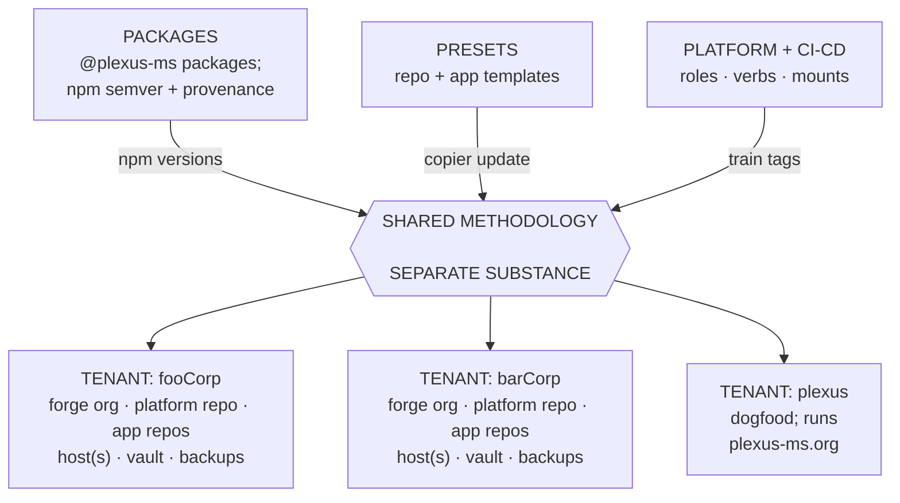

Plexus is a coherent collection of opinionated guidelines and approaches in information technology.
The ambition is that everything its maintainers know about IT is eventually encoded here, which mainly revolves around building software and operating it.

This document, referred to as the Plexus Standard, PLX, or simply "the standard", is the map of that collection.
Each section explains the concern and points at the **modules** that cover it; where no module exists yet, a stub says so.
Requirements live only in the modules themselves.

*Cite a map section by number and the short name PLX ("§ 4.1 PLX"); cite a module section by number and the module's code ("§ 2 PLX-App").
Section numbers are append-only within a major version: new sections go at the end of their level, so a citation stays correct until the next major release.*


## § 1 General provisions

### § 1.1 Structure and normative language

The standard has two layers.
The **map** is this document: prose and pointers, no requirements, no normative keywords.
A **module** is a page under `contracts/` or `approaches/` that covers one concern a consumer could adopt or reject on its own, and it is where requirements live.

A module at standard maturity (§ 1.3) states its requirements as blockquoted bullets at the head of each numbered section, using the capitalised keywords of BCP 14 ([RFC 2119](https://www.rfc-editor.org/rfc/rfc2119), [RFC 8174](https://www.rfc-editor.org/rfc/rfc8174)).
Everything outside such a bullet is informative: the prose below a requirements block explains and motivates, but never binds.

### § 1.2 Vocabulary

The following terms are used throughout Plexus.

Plexus revolves around tenants sharing methodology but never substance:

- **Tenant** — one trust domain in the federation: its own forge org, repos, hosts, secrets vault, backups ([PLX-Tenancy](../contracts/tenancy.md)).
  The boundary that matters is access and trust, not necessarily legal personality.
- **Methodology** and **substance** — the sharing axis: methodology is knowledge and code-shaped-as-knowledge, shared across all tenants; substance is data, secrets, access, hosts, and is never shared.
- **Primitive** — any named methodology (guideline, tool, or approach) the initiative ships or prescribes: a verb, a mount, an Ansible role, a published package, a copier template, a label scheme, a file layout, an endpoint path.
  Decided once, reused, versioned and published, or otherwise propagated (§ 13).
- **Seam** — where two sides owned by different people or tools meet: one layer and the next, or the authors of a repo and whatever runs it.
  A seam is named by its two sides and made explicit as exactly one contract (§ 1.3).
- **Module**, **contract**, **approach**, **maturity** — see § 1.3.
- **Declaration** — a repo's or app's `PLEXUS.md` marker: the Plexus version it was brought up to and the modules it follows (§ 1.4).
- **Train** — one release of Plexus, tagged identically on every train repo and the compendium, whose number is the Plexus version (§ 1.5).

Tenants usually build and ship software:

- **Repo** — one release cycle and one toolchain inside a tenant bundled in one forge repository ([PLX-Repo](../contracts/repo.md)).
  A tenant can have any number of **app repos** holding the dev side, and has exactly one **platform repo** holding the ops side.
- **App** — one deployable unit satisfying the app contract ([PLX-App](../contracts/app.md)).
  It lives in an app repo for software the tenant builds, or the platform repo for third-party software the tenant merely operates.
- **Verb** — a stateless, hand-runnable procedure that does one operational thing, authored portably.
  Ops verbs are the shared bash scripts `ci-cd` ships; contract verbs are the root mise tasks the repo contract requires.
- **Mount** — the thin, disposable glue binding a verb or role to an event or state source it does not own: a workflow wrapper on forge events, a tenant playbook on an inventory, a systemd timer on the clock.
  Mounts carry no logic.

IT operations is a layered concern. We are adopting the commonly used language of on-premises, IaaS, PaaS, and SaaS:

- **App/Software layer** — on top of the platform layer, the software a tenant provides as a service and the data it holds: the apps the tenant builds in its app repos and the third-party apps it merely operates from its platform repo, each meeting the app contract ([PLX-App](../contracts/app.md)).
  It is the equivalent of a tenant being its own SaaS provider, and it is the dev side: everything from the domain core up to the seam where the platform provides the surroundings.
- **Platform layer** — what makes any existing production host run a tenant's app and provide it as a service: the host baseline, the container engine and proxy, ingress, environment and secrets delivery, applied by the platform repo's playbooks ([PLX-Platform](../approaches/platform.md)).
  It is the equivalent of a tenant being its own PaaS provider, running the layer between the infrastructure below and the apps above.
- **Infrastructure layer** — underneath the platform layer, this is what makes a tenant's hosts exist, reachable, and restorable: bought from a provider as IaaS (virtualized cloud instances etc.), or built by the tenant on bare metal of its own (on-premises or bare metal rented from a provider, [PLX-Infrastructure](../approaches/infrastructure.md)).


### § 1.3 Modules and maturity

A module has a kind and a maturity, and the two are independent axes.

#### Contracts and approaches
The modules' kind divides them into `contracts/` and `approaches/`.

- A **contract** is the module written at a seam: what the two sides owe each other, so that either side can be replaced without the other noticing.
  Contracts are opinionated interfaces, not tool-neutral ones: the repo contract names mise, the app contract names compose, the host contract names Debian.
  See the [contracts index](../contracts/index.md) for the table of all seams.
- An **approach** is an opinionated way to live on one side of a seam: to provide a contract, to consume it, or to do a side's own job; every module that is not a contract is one.
  A tenant can replace an approach with its own and remain a Plexus tenant as long as it keeps the contracts.

**Three rules for contracts and approaches:**

- One seam, one contract; a contract may have profiles, which are parts of it and not seams of their own.
  A new contract needs a new named seam with two owners, and a page that cannot name its seam is an approach.
- A module reaches across a seam only through a contract, and says so in `consumes`; `depends` stays on its own side and is composition: you took this piece, so you have the whole it belongs to.
  `mise verify` refuses a `consumes` entry that is not a contract, a `depends` entry that crosses the dev/ops seam (`repo` and `app` against `host` and `organisation`), and any dependency of a contract on an approach.
- A contract page is two-sided: its sections say which side they bind, and its Maintaining section lists the approaches on each side.
  A guarantee that one side relies on from an approach on the other side moves into the contract at that seam, and the approach keeps the how.

#### Maturity: note vs. candidate vs. standard
- A **note** is written knowledge: no primitives, no requirements; a page the map links to and nothing more.
- A **candidate** has shipped primitives and at least one consumer, and still no requirements: a candidate for standard, waiting on its second consumer.
- A **standard** module has requirements and at least two consumers.

Only candidate and standard modules carry a code, `PLX-` plus one capitalised word, unique across the compendium, and only they can be declared.
Notes have titles and no code.

#### Granularity
Modules are cut for understanding: one module per concern a reader can hold in their head, so that someone who needs to know how delivery works reads one page and not four.
A module says at each section which kind of consumer it binds, and a consumer that follows a module without one of its sections owns that in its marker body.
Ingress, secrets delivery, and backups are separate modules because they are separate concerns to the reader, although one playbook mounts them; the delivery verbs, the branch model and the deploy semantics are one module because a reader of any of them needs the others.
Granularity is revisited while pages are written and when a reader has to hold two pages open.

#### Frontmatter
Every module page carries `code` (except for notes), `maturity`, `binds` (what the module is declared for: `repo`, `app`, `host`, or `organisation`), `depends` (the codes on the same side of every seam that a declaration of this module has to accompany), on approaches `consumes` (the contracts on the other side of a seam this module relies on, declared by that side), and, on standard modules only, `changed`, the train in which the module's requirements last changed.

#### Page shape
Numbered sections (`§ 1`, `§ 1.1`, …) hold requirements as `> - ` bullets followed by consumer prose; numbers are append-only within a major train, as in the map.
One trailing section headed *Maintaining*, unnumbered and never cited, holds the maintainer side: which primitives ship the module, what changes with it, what debts it carries, when it is promoted.
The extractor treats that section as prose.

### § 1.4 The declaration marker

A consumer says what it follows in a `PLEXUS.md` marker at the root of each repo and each app:

```markdown
---
plexus: 0.60.0
modules: [PLX-Repo, PLX-JS, PLX-Delivery, PLX-Updates]
---

- Free-form prose: what this repo is, how to find your way.
- Owned deviations, one bullet each, with rationale.
```

`plexus` is the Plexus version the repo or app was last brought up to; `modules` is the list of module codes it follows.
Machine checks read only the frontmatter; the body is for humans, and it is where a deviation from a requirement is owned in a sentence of rationale..

**Dependencies.**
A module's `depends` (§ 1.3) is satisfied by the declaring unit itself, by an enclosing declaration (an app's by its repo, a repo's by the tenant's platform repo), or by a contained one (a repo's by an app inside it).
What a module `consumes` is never the declaring unit's to satisfy: PLX-Ingress consumes PLX-App, and it is the apps that declare PLX-App; PLX-Platform consumes PLX-Host, and the side that provides the host declares it, or, for a rented machine, nobody does.
The staleness check (§ 13.4) verifies the first and leaves the second to the other side.

**Staleness is per module.**
A declaration is stale for exactly those modules it lists whose `changed` is newer than its `plexus`; nothing else about it is stale.
There is no global verdict.

### § 1.5 Versioning and the train

Plexus has one version: the number of the **train**, a plain semver tag (`0.60.0`, no `v` prefix) stamped identically on every train repo, whether or not it changed, and on the compendium.
The number says *when*, not *how stable*; stability is the maturity axis of § 1.3.
The train is the tested set: the only combination ever validated is the one the maintainers' tenants run together, so independent per-repo version lines would name compatibility cells nobody tests.
Because an unchanged repo still gets the tag, every cross-repo pin can cite the train version and be right by construction.

The train repos are `platform`, `ci-cd`, `preset-repo-web`, `preset-app-nextjs`, `preset-repo-platform`, and `compendium`.
`packages` (npm semver via changesets, [§ 5 PLX-Delivery](../approaches/delivery.md)) and `renovate-config` (read from its default branch) ride outside the train.
Within the train, `ci-cd` tags verbs and reusable workflows together, so a workflow always checks out its verb at the same tag; `platform` tags the Ansible collection and the Terraform modules together, and its `galaxy.yml` version mirrors the tag exactly.
The pre-train per-repo `vN` lines and the itops-era tags live on frozen in history, kept for existing pins and never retargeted.

**Semver attaches to maturity.**
A breaking change to a standard module's requirements forces a major train, with migration steps noted in the module; candidate and note modules change in any minor train.
Minor bumps are routine trains, patch is reserved for hotfix trains.
Section numbers in the map and in every module are append-only within a major train, so a citation written against one train stays right until the next major.
The train reaches 1.0.0 once the modular standard with its first standard modules has shipped and settled; until then `0.x` promises nothing, and any train can change anything.

**What `ship` writes.**
`plx ship`, run from the maintainers' `toolbox`, writes the bookkeeping, tags every train repo, pushes, and copier-updates the consumers in one pass.
For the compendium it writes the version and timestamp in this document's frontmatter (a draft carries `v0` until its first train) and stamps `changed` on each standard module whose extracted requirement lines differ from the previous train's, using the same extractor `mise check` runs.

### § 1.6 Upstream guarantees

Whoever controls `plexus-ms` ships code and knowledge-shaped-as-code that reaches deep into every tenant's hosts, inside every tenant's CI, and inside every tenant's apps.
Adopting the standard means trusting its maintainers.
The mitigations are structural, and the tenant can rely on them:

- The `plexus-ms` repos are public and GPLv3-licensed; every change is reviewable, and nothing breaks on the day the upstream goes unmaintained: published versions keep resolving, tags keep resolving, and the repos remain forkable.
- `@plexus-ms/*` packages are published to the public npm registry through OIDC trusted publishing; published versions are immutable and carry provenance attestations linking each version to its source commit and build.
- A breaking change to a package is released as a semver major, with a migration note in the changelog; a breaking change to a standard module is a major train (§ 1.5).
- Tenant substance, business logic, secrets, anything tenant-specific, never appears in a public package or a public repo.

These are obligations of the maintainers, not of consumers, which is why they are prose here rather than requirements in a module.
They are the upstream's side of the tenant-to-federation seam (§ 1.3), whose tenant side is [PLX-Tenancy](../contracts/tenancy.md).
The tenant's decision on how unattended to let updates flow ([§ 2 PLX-Updates](../approaches/updates.md)) rests on them.

One sharp edge is named rather than implied away: some pins reference git tags, which are movable.
Unlike npm versions, a retargeted tag silently changes what a tenant executes, with no attestation.
Referencing by commit SHA is the immutable alternative; for now the trade-off of readability and update-bot flow over immutability is accepted deliberately, the update bot's stratification treats tag-referenced artifacts accordingly, and the decision is revisited if attestation for tag-referenced artifacts becomes practical.

The repos that ship the methodology:

| Repo | Offering |
|---|---|
| `packages` | The published `@plexus-ms/*` packages for the web/Node/TypeScript world: shared tool configs, the `std` utilities, and over time the reusable application plumbing that keeps each app's domain core small. |
| `platform` | The `plexus.platform` Ansible collection: the host baseline, the roles that make a host a tenant's app host, the roles of the infrastructure layer; plus reusable Terraform modules. |
| `ci-cd` | The portable bash verbs (`deploy.sh`, `changed-apps.sh`, `deploy-targets.sh`) and the thin reusable workflows that mount them on the forge. |
| `preset-repo-web` | The copier template for a tenant app repo: a web monorepo with `apps/` consuming the packages, re-syncable via `copier update`. |
| `preset-app-nextjs` | The copier template for a Next.js app inside an app repo: contract-verb scripts, Dockerfile, `compose.yaml` with the contract labels. |
| `preset-repo-platform` | The copier template for a tenant's platform repo: the two playbooks, on request a third for the infrastructure layer, inventory, the `op://`-pointer env files, the collection pin, the `apps/` directory and workflow for third-party apps. |
| `renovate-config` | The shared Renovate preset every tenant repo extends in one line. |
| `compendium` | This map, the modules, the manifesto, and the supporting reference docs. |

The dogfood tenant `plexus` lives in its own organisation, `plexus-ms-tenant`, laid out like any tenant and bound by the modules it declares, not by anything in this section: the maintainers' organisation ships methodology, the tenant's holds substance, and the two never share an access boundary.



*Figure 1 — the federation at a glance: one tenant-neutral upstream, versioned methodology flowing hub-and-spoke to every tenant, substance staying inside each tenant's own trust domain.*

### § 1.7 Governance

Deferred decisions are written into the module or map stub that owns its concern, with the trigger that reopens it, so that the stubs of this map are the overview of what Plexus does not cover yet, and a deferral is a decision rather than drift.

### § 1.8 Compendium conventions

All documentation of the initiative lives in the `compendium` repo.
No other `plexus-ms` repo carries a README beyond a pointer or a one-liner; a role's variables are documented in its defaults, a verb in its header.

Two registers.
The [Manifesto](manifesto.md) says why, and evocative language is allowed there and nowhere else.
This map and the modules say what and how, in sober prose; the modules' requirements in BCP 14, their Maintaining sections in plain rules for the maintainers.

The structural conventions are self-policing, and the machinery is small:

- The map carries no requirement and no normative keyword.
- A standard module carries its requirements as `> - ` lines under numbered headings; blockquotes are reserved for them.
- A module below standard maturity carries neither keyword nor blockquote.
- `plx requirements` checks all of that over the map and every module, validates module frontmatter, and prints a module's requirement lines on demand; `mise check` runs it, and the pre-commit and pre-push hooks run `mise check`.
  It writes no file: there is no generated requirements list to keep current.
- Section numbers are append-only within a major train; insertions wait for a major.
- Module pages live at `contracts/<slug>.md` or `approaches/<slug>.md`, the folder being the kind (§ 1.3), and a new module is added to the map section that owns its concern in the same commit.

The compendium follows the repo contract it documents: tools pinned in `mise.toml`, `verify` as a verb, hooks through hk.


## § 2 Organisation

How an organisation is cut into trust domains and named, where its code lives, how it relates to other tenants, and the parts of running an organisation that are not technical at all.

### § 2.1 Trust domains and tenancy

The tenant is the trust boundary: one organisation, one forge org, one platform repo, one secrets vault, its own hosts and backups.
What spans tenants is methodology; what never does is substance.
[PLX-Tenancy](../contracts/tenancy.md) is the contract, at standard maturity; its first section holds the one pair of requirements everything else rests on.

### § 2.2 Naming

One short slug per tenant threads through every layer: forge org, hostnames, inventory groups, vault name, and the `plexus.tenant` label on every deployed service, so that staring at a host one can tell whose service this is.
[§ 2 PLX-Tenancy](../contracts/tenancy.md).

### § 2.3 Forge and repo layout

One trust domain, N release cycles, one platform repo: the ops side in a repo of its own, every other repo an app repo, app repos as monorepos by default, generated from the presets.
[§ 3 PLX-Tenancy](../contracts/tenancy.md).

### § 2.4 Arrangements between tenants

Tenants sharing hardware are separated by a hypervisor and never inside one VM; the hypervisor side sees everything, so distinct legal persons sharing root access write the arrangement down.
The common form is one tenant obtaining its infrastructure from another ([PLX-Infrastructure](../approaches/infrastructure.md)).
[§ 4 PLX-Tenancy](../contracts/tenancy.md).

### § 2.5 Documentation and knowledge

Plexus's own stance is that artifacts are the documentation (the [Manifesto](manifesto.md)) and that a tenant repo's marker body is where its non-derivable knowledge lives; how an organisation keeps the knowledge that is not next to a system (runbooks, decisions, onboarding, user manuals) is not in our scope for now.

### § 2.6 Legal and data protection

The only requirement in this area today is the written arrangement of § 2.4, with a data-processing agreement where applicable.
Moving tenants off shared metal can be triggered by a customer with real data-processing expectations: not because the hypervisor stops isolating, but because "dedicated instance for us only" can be a compliance or trust requirement independent of the technical reality.

### § 2.7 Cost, vendors, procurement

Where the standard picks a vendor today it does so inside a module, as a suggested pragmatic default chosen by the maintainers, which a tenant can substitute by recording the deviation.

A more holistic view on cost and vendor choice across the whole stack may follow in the future, but tenants will have vastly different needs and budgets.


## § 3 Shared services

The services an organisation runs for itself and its people rather than for one app: identity, secrets, domains, mail.
Each is consumed by a module below; none has a module of its own yet.

### § 3.1 Identity and access for people

The platform's host baseline gives each human admin a personal account with key-only SSH ([§ 2 PLX-Platform](../approaches/platform.md)).

The forge org governs code access ([§ 3 PLX-Tenancy](../contracts/tenancy.md)).

Identity providers for the organisation's people and apps are operated as third-party apps today and have no dedicated module.

More approaches to identity and access may follow in the future.

### § 3.2 Secrets

Every module that needs a secret assumes one secrets vault per tenant, as the tenant is the trust boundary.

Today the standard assumes an external secrets service, with 1Password as a suggested default, reachable by a CLI that resolves `op://`-style pointers; [PLX-Secrets](../approaches/secrets.md) is how the platform consumes it.

More approaches to secrets management and more services may follow in the future.

### § 3.3 Domains and DNS

Not covered yet.

A public host is deployment substance bound to an app in the tenant's inventory ([PLX-Ingress](../approaches/ingress.md)); how the DNS zone itself is held, delegated, and changed is still to be decided.

Approaches on DNS and domain management with a focus on bringing DNS state into Git and managing it IaC-style will follow in the future.

### § 3.4 Mail

Hosts send local mail to a mailbox through a relay the tenant provides (the `configure_mail` role); apps send through a transactional provider from their environment; neither is a standard module today.

More approaches to mail may follow in the future.


## § 4 Development

Everything a repo does before an artifact exists: the one way to run it, the toolchain behind that, how code is shared, tested, and run locally.

### § 4.1 Repo contract

A declaration marker, mise and hk as the one executable answer to "how do I run you", and the three standard verbs `dev`, `build`, `verify`, each answering from a fresh checkout, with `lint`, `check` and `test` as the recommended decomposition of `verify`.
[PLX-Repo](../contracts/repo.md) is the contract every other repo- and app-level module depends on.

### § 4.2 Toolchains

The incantations behind the verbs, one module per stack.
JS/TS is specified: pnpm workspace plus Turborepo, node pinned once, dev tools as devDependencies, Biome ([PLX-JS](../approaches/js.md)).
Other stacks take the repo contract with a toolchain module still to be written.

More toolchain modules may follow in the future.

### § 4.3 Sharing code

The standard approach to share code across repos is a published, versioned artifact, and nothing else should cross the boundary.
This is not possible in all cases, and the fallback is a template synced up with e.g. copier, or even manual sync, but this should be treated as a rigorous ladder to step through:
1. versioned artifact, if possible;
2. template, if the first is not possible;
3. manual sync, if the first two are not possible.

In a JS monorepo, code that does not need to cross repo boundaries can just be an unpublished package in that monorepo.

[§ 1 PLX-Updates](../approaches/updates.md) states the rule; [§ 5 PLX-Delivery](../approaches/delivery.md) is how a JS package repo publishes.

### § 4.4 Testing

Not covered beyond the verb.
`verify` runs whatever gates a release and provides its own environment ([§ 3 PLX-Repo](../contracts/repo.md)); what a good test suite for a Plexus app looks like, and how the domain core is engineered test-first while the edges are shared, is still to be written.

More approaches to testing will follow in the future.

### § 4.5 Local environment

Not covered beyond the verb.
`dev` takes a fresh checkout to a running development environment, and the app's `compose.yaml` runs identically in development with a local `.env` ([§ 3 PLX-App](../contracts/app.md)); development-only services next to it are each app's business today.

More approaches to local development environment standardization may follow in the future.

### § 4.6 Application plumbing

The "standardize boundaries" edges, framework glue, common auth concerns, repeatable non-domain features, are to become published `@plexus-ms/*` packages, extracted when a second app needs the same plumbing ([§ 5 PLX-Delivery](../approaches/delivery.md)).
Until then the plumbing lives in the app that needs it.

General re-use of plumbing and boilerplate is encouraged per the DRY principle.

### § 4.7 Working with coding agents

Not covered yet.

Approaches to coding agents will follow in the future.


## § 5 Application

The seam between dev and ops, made explicit as a contract an app satisfies and a profile sharpens.

### § 5.1 App contract

Run shape in `compose.yaml`, environment through two files, one HTTP port on loopback, a readiness `/healthz`, logs on stdout, and a CI reference: the profile-neutral base the platform relies on for every app.
[PLX-App](../contracts/app.md).

### § 5.2 Profiles

Every app takes exactly one.
[PLX-AppStateless](../contracts/app-stateless.md) for apps holding no state; [PLX-AppStateful](../contracts/app-stateful.md) for apps with data services of their own, with backup labels, an idempotent one-shot `migrate`, expand/contract discipline, and a seed task.
Further profiles append here as they are needed.

### § 5.3 Background jobs

The stance for now is: app-internal pipelines run in a job queue inside the app, deployed as a worker container in the same compose file (the [scheduling note](../approaches/scheduling.md)); a profile or note on the worker's shape is still to be written.

More approaches to background jobs and centralized orchestration may follow in the future.


## § 6 Delivery

From a verified commit to a running container or a published package: three verbs, the workflows that mount them, branches and promotion, and what happens when a deploy fails.
One module covers the span, [PLX-Delivery](../approaches/delivery.md); the subsections below point into it.

### § 6.1 Branch model

`main`→prod, `develop`→staging, a release is an image keyed by SHA, hotfixes back-merge immediately, no changesets in app repos.
[§ 3 PLX-Delivery](../approaches/delivery.md).

### § 6.2 Deployment and promotion

The app is the unit of deployment, the repo the unit of promotion: a merge deploys exactly the apps whose sources changed, and promotion is the whole repo, never selective.
[§ 3 PLX-Delivery](../approaches/delivery.md).

### § 6.3 Verbs, workflows and the pipeline

Three verbs, `verify`, `release`, `deploy`, each a job; a workflow is the occasion that mounts them: `verify.yml` on every push, `deploy.yml` or `release.yml` on the environment branches, verifying first within the same run, fanned out per changed app through one reusable pipeline; no tenant operates a CI control plane.
[§§ 1 and 2 PLX-Delivery](../approaches/delivery.md).
Where the jobs run, the forge's runners or a runner host of the tenant's own, is [§ 8 PLX-Delivery](../approaches/delivery.md).

### § 6.4 Deploy semantics

Render the compose file with the image pinned, pull, migrate, swap, up, poll readiness, roll back on failure, store nothing.
[§ 6 PLX-Delivery](../approaches/delivery.md), prose without requirements until a second deploy verb exists, with the fence around the verb in the module's Maintaining section.

### § 6.5 Failed deploys and recovery

A red staging deploy parks promotion; recovery is a re-run of the failed job or a hand-run verb, never an empty commit.
[§ 7 PLX-Delivery](../approaches/delivery.md).

### § 6.6 Releasing libraries

Trunk-based, versioned by changesets, published token-less through OIDC trusted publishing with provenance.
[§ 5 PLX-Delivery](../approaches/delivery.md); releasing an image is [§ 4 PLX-Delivery](../approaches/delivery.md).

### § 6.7 Image registry

Not covered beyond the default behavior of GHCR currently.

Will be revisited and expanded when the need arises.

### § 6.8 Preview environments

Not covered yet.

A single staging per app covers most of the value; per-PR environments might follow in the future.

### § 6.9 Zero-downtime deploys

Not covered yet.

The deploy verb re-creates containers in place and accepts seconds of downtime per deploy.

Blue-green or rolling deploys might follow in the future.


## § 7 Platform

A tenant's hosts as code: the Ansible collection mounted as playbooks, and the concerns the roles cover on an app host.

### § 7.1 Playbooks

Two playbooks split by change cadence, provision for fresh hosts and deep changes, configure as the re-runnable everyday pass, each role wholly in one.
[§ 1 PLX-Platform](../approaches/platform.md).

### § 7.2 Host baseline

Packages and system activity record, personal admins, unattended security upgrades, a default-drop firewall assembled from fragments, sshd closed to root; the deploy user and the container engine on an app host.
[§ 2 PLX-Platform](../approaches/platform.md).

### § 7.3 Ingress

The proxy's routes are rendered from the app record, public host to loopback port, and `/healthz` is fenced at the edge; the proxy is the substitutable piece.
[PLX-Ingress](../approaches/ingress.md).

### § 7.4 App environment and secrets delivery

Git holds `op://` pointers, the configure playbook resolves them into `.env.secret` on the host and re-creates the containers whose environment changed; the deploy verb never touches a secret.
[PLX-Secrets](../approaches/secrets.md).

### § 7.5 Scheduling

No orchestrator; scheduled jobs are systemd timers, and a job that silently stops is noticed by a dead-man's-switch whose mechanism is still open.
A [note](../approaches/scheduling.md) until the mechanism ships.

### § 7.6 Host lifecycle

Unattended security upgrades on, every other host change a supervised act, until patch drift is visible enough for an honest policy.
A [note](../approaches/host-lifecycle.md) until a policy exists that a role enforces.

### § 7.7 App record and lifecycle

One inventory record per app binds name, source repo, host, loopback port, and values; the configure playbook lays out the app's directory, writes `.env` from the record, and pulls and starts what the deploy verb has placed.
[§ 3 PLX-Platform](../approaches/platform.md).


## § 8 Infrastructure

What is below the platform: the contract a host satisfies before its first playbook run, and the two ways a host comes to exist.

### § 8.1 Host contract

A Debian machine an operator can reach over SSH, with a stable name, outbound internet, and ports 80 and 443 reachable directly or through a layer-4 ingress.
[PLX-Host](../contracts/host.md), written informatively at candidate maturity.

### § 8.2 Rented machines

Not covered.
A tenant on a provider's cloud has nothing to do below the host contract; which providers, which machine shapes, and how the platform repo records them is still to be written.

### § 8.3 Virtualisation

A Proxmox hypervisor on Debian, bound to the overlay, with a default-drop firewall and backup jobs for every guest; the hypervisor's control plane keeps guest state below the platform, the one named trade-off against state in git.
[§ 2 PLX-Infrastructure](../approaches/infrastructure.md).

### § 8.4 Guests

Created from the stock Debian cloud image with Proxmox's cloud-init, no template and no image of the tenant's own, the roles doing everything else on the first run.
[§ 2 PLX-Infrastructure](../approaches/infrastructure.md).

### § 8.5 Network edge

An ingress VM holding the one public address, routing 443 by SNI and 80 by Host header to the tenant VMs without terminating anything, NAT for their outbound traffic.
[§ 3 PLX-Infrastructure](../approaches/infrastructure.md).

### § 8.6 Admin network

Not covered as a module.
Hosts join an overlay network (the `install_and_join_netbird` role) and are administered over it; the hypervisor's UI and the backup server listen only there.
Whether the overlay, its control plane, and the fallback when it is down become a module is still to be decided.

### § 8.7 Hardware and providers

Not covered.
Which hardware a hypervisor runs on, where the backup server sits, and how an off-site copy is held are a tenant's own facts today.


## § 9 Workplace

Not covered yet.


## § 10 Security

A discipline applied to everything above, not a layer of its own.
What exists is spread across the modules; this section collects where.

### § 10.1 Hardening and remote access

The host baseline: key-only SSH for personal admins, root closed after the first run, a default-drop firewall, unattended security upgrades ([§ 2 PLX-Platform](../approaches/platform.md)); administration over an overlay network (§ 8.6).
A module that states the posture as requirements is still to be written.

### § 10.2 Supply-chain pins

Immutable, provenance-attested packages, movable tags named as the accepted edge (§ 1.6), and an update-bot stratification by blast radius so that nothing new runs as root without a human reading the diff ([§ 2 PLX-Updates](../approaches/updates.md)).

### § 10.3 Network isolation

Not covered beyond tenancy.
Tenants are separated by hypervisor and never share a VM ([§ 4 PLX-Tenancy](../contracts/tenancy.md)); apps publish to loopback only and reach the world through the proxy ([§ 4 PLX-App](../contracts/app.md)); isolation between guests of one hypervisor is still to be written.

### § 10.4 Vulnerabilities

Not covered yet.
Patching is the interim posture of the [host lifecycle note](../approaches/host-lifecycle.md); scanning images and dependencies for known vulnerabilities is still to be written.

### § 10.5 Incidents

Not covered yet.


## § 11 Data and resilience

What survives a lost host, a bad release, or a mistake: backups, restores, and how data is operated and retired.

### § 11.1 Backups per service

Per-service dumps discovered from `plexus.backup` labels, an off-site repository, a hand-runnable restore verb.
Designed and not yet shipped: [backups per service](../approaches/backup.md) is a note until the handlers exist.

### § 11.2 Backups of whole machines

The infrastructure layer's backup server takes every guest, encrypted, pruned and verified on its own schedule, with an off-site copy; what covers a tenant's data until § 11.1 ships.
[§ 3 PLX-Infrastructure](../approaches/infrastructure.md).

### § 11.3 Restore testing

Untested backups are not backups: a new backup path passes one end-to-end restore before it is relied upon, and a scheduled restore test raises its own missed-job alert.
Stated in the [backups note](../approaches/backup.md); the tenant running whole-machine backups drills restores by hand today.

### § 11.4 Disaster recovery

Not covered yet.
A stateless app is reconstructable from git and the registry; a host from the playbooks; data from § 11.1 or § 11.2; what the ordered procedure for a whole tenant looks like is still to be written.

### § 11.5 Operating databases

Not covered yet.
The stateful profile defaults to one database container per app that dies with it ([§ 1 PLX-AppStateful](../contracts/app-stateful.md)); upgrades of the engine, tuning, and when a shared instance is warranted are still to be written.

### § 11.6 Retention and deletion

Not covered yet.
Backup retention is the backup server's schedule; application-level retention and deletion on request have no stance yet.


## § 12 Observability

Knowing what runs where and whether it is healthy.

### § 12.1 Missed-job alerts

A scheduled job that fails or does not run raises an alert; the dead-man's-switch mechanism, a ping service or a staleness watcher, is decided together with the rest of this section.
The [scheduling note](../approaches/scheduling.md).

### § 12.2 Metrics

Not covered yet.
The host baseline records system activity locally (sysstat) and an observability agent is an opt-in role; what collects, where, and what is looked at is still to be decided.

### § 12.3 Logs

Not covered beyond the contract.
Apps write to stdout and stderr and never manage log files ([§ 6 PLX-App](../contracts/app.md)); shipping and retention are the platform's job and have no module.

### § 12.4 Alerting channels

Not covered yet.
Today a failed deploy alerts as the failing CI job, hosts mail failed units to a mailbox, and a monitor notifies however it natively can; who gets woken, and how, is decided together with observability.

### § 12.5 Uptime

Not covered yet.
`/healthz` is fenced from the public precisely so that it does not become an uptime oracle; a tenant pointing an external monitor at it records the deviation ([§ 2 PLX-Ingress](../approaches/ingress.md)).

### § 12.6 Capacity

Not covered yet.
Kubernetes is revisited only on genuine multi-node scheduling, contractual HA-SLA, or team-coordination needs, none anticipated for years: single hosts with Compose scale far past small-tenant needs, the bottleneck will be the database and operator time long before Compose, and self-hosted Kubernetes would worsen the bus factor.


## § 13 Upkeep

Keeping every consumer current with the decisions made once upstream.

### § 13.1 Propagation as versioned dependency

A shared thing crosses a repo boundary only as a published, versioned artifact: packages, the workflow and verbs by train tag, the collection by train tag; consumers extend and override at the edge, never fork the base.
[§ 1 PLX-Updates](../approaches/updates.md).

### § 13.2 Update bot

Every tenant repo runs a bot that watches its pins; how unattended a merge is follows the blast radius, from packages merging on green CI to the collection always waiting for a human.
[§ 2 PLX-Updates](../approaches/updates.md).

### § 13.3 Templates and re-sync

What cannot be a dependency arrives through a copier template and is re-synced on the train by `copier update`; the three scaffolding tiers decide where a new artifact goes.
[§ 3 PLX-Updates](../approaches/updates.md).

### § 13.4 Staleness check

A hand-runnable verb in the maintainers' toolbox, `mise run staleness`, reads every marker in the workspace, compares each declared module's `changed` with the marker's `plexus`, verifies that every dependency is declared where § 1.4 says it is satisfied, and prints what is behind; it fixes nothing.
It ships with train 0.61.0, after the first stamps of 0.60.0 gave it something to compare.
Mounting it on a schedule in each tenant, so that a tenant sees its own staleness without the maintainers' workspace, is the next step and waits for a tenant that is not also the maintainer.

### § 13.5 Tooling

The maintainers' helpers are commands of `plx`, the published `@plexus-ms/cli`: the workspace map, the staleness check (§ 13.4), the train (§ 1.5) and the requirements check (§ 1.8); the ops verbs are bash still, each hand-runnable and checked.
The case for the tool, what it must not become, and the order in which the remaining verbs move is recorded in the [CLI note](../approaches/cli.md).
